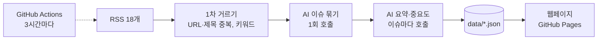

# 반도체·디스플레이 뉴스 AI Agent

반도체·디스플레이 업계 뉴스를 **3시간마다 자동으로 모으고**, 같은 이슈를 다룬 **중복 기사를 하나로 묶고**, **한국어로 요약**하고, 내가 정한 기준으로 **중요도를 판단**해 웹페이지로 보여주는 AI Agent입니다.

- 웹페이지: Vercel 배포 주소 (GitHub Pages 주소 `https://smyz1203.github.io/semicon-news-agent/`도 함께 동작)
- 수집 매체: 국내 9개 · 해외 9개 RSS (디일렉, 전자신문, KIPOST, 연합뉴스, Semiconductor Engineering, TrendForce, OLED-info 등)
- AI: OpenAI API (기본) 또는 Claude API — `config/settings.yaml`의 `provider` 한 줄로 전환

## 왜 만들었나

뉴스를 직접 찾아 읽으면 검색과 확인에 시간이 많이 들고, 같은 이슈를 다룬 기사가 여러 매체에 반복돼 중요한 정보를 골라내기 어려웠습니다. 이 반복 작업을 자동화된 workflow로 바꿨습니다.

| 기능 | 하는 일 |
| --- | --- |
| 수집 | 국내·해외 RSS 18개에서 마지막 실행 이후 올라온 기사를 가져옴 |
| 중복 제거 | URL·제목 유사도로 1차 정리한 뒤, AI가 같은 사건을 다룬 기사(국문·영문 포함)를 하나의 이슈로 묶음 |
| 선별 | 키워드 필터 + AI 관련성 판단으로 무관한 기사 제외 |
| 요약·분류 | 이슈마다 한국어 3줄 요약, 카테고리, 키워드 태그 |
| 중요도 판단 | `config/settings.yaml`의 기준으로 1~5점과 판단 근거를 매기고, 4~5점은 웹 상단 "주요 이슈"에 |
| 자동 업데이트 | GitHub Actions가 3시간마다 실행하고 Pages에 배포 |

## 작동 방식



자세한 설계는 [docs/design.md](docs/design.md)에 있습니다.

## 폴더 구조

```
agent/          Python Agent
  main.py         전체 흐름 실행
  collect.py      RSS 수집
  dedupe.py       1차 중복·관련성 거르기
  analyze.py      AI(OpenAI/Claude): 이슈 묶기, 요약·중요도
  prompts.py      AI 지시문
  store.py        JSON 저장
  build_site.py   웹페이지 만들기
  health.py       실행 결과 점검
config/         설정 (모델, 한도, 카테고리, 중요도 기준, RSS 목록)
data/           Agent 결과 (Actions가 자동 커밋)
web/            웹페이지 (HTML/CSS/JS)
tests/          테스트
docs/design.md  설계 문서
```

## 내 컴퓨터에서 실행하기

Windows PowerShell 기준입니다.

```powershell
# 1. 가상환경 만들기와 패키지 설치 (처음 한 번)
py -3.12 -m venv .venv
.\.venv\Scripts\python.exe -m pip install -r requirements.txt

# 2. API 키 넣기: .env.example을 복사해 .env를 만들고 OPENAI_API_KEY(또는 Claude면 ANTHROPIC_API_KEY)를 붙여넣기
Copy-Item .env.example .env
notepad .env

# 3. AI 없이 수집만 해보기 (비용 0원)
.\.venv\Scripts\python.exe -m agent.main --dry-run

# 4. 소량만 실제로 실행 (결과는 local-data/ 폴더에, GitHub에는 안 올라감)
.\.venv\Scripts\python.exe -m agent.main --limit 5 --data-dir local-data

# 5. 웹페이지 미리보기 → 브라우저에서 http://localhost:8000
.\.venv\Scripts\python.exe -m agent.build_site --data-dir local-data
.\.venv\Scripts\python.exe -m http.server 8000 -d _site

# 테스트
.\.venv\Scripts\python.exe -m pytest -q
```

## 설정 바꾸기

모두 `config/` 폴더의 YAML 파일만 고치면 됩니다.

| 바꾸고 싶은 것 | 파일 · 항목 |
| --- | --- |
| 중요도 기준, 관심 기업 | `settings.yaml` → `importance` |
| 카테고리 | `settings.yaml` → `categories` |
| AI 제공사 (OpenAI ↔ Claude) | `settings.yaml` → `provider` (`openai` 또는 `claude`) |
| AI 모델, 생각 깊이(effort) | `settings.yaml` → `openai.model` / `claude.model`, `effort` |
| 비용 한도 (실행당 기사·요약 수) | `settings.yaml` → `limits` |
| 수집 매체 추가·끄기 | `sources.yaml` |
| 실행 주기 | `.github/workflows/update.yml` → `cron` |

## Vercel 배포

`vercel.json`에 설정이 들어 있어, Vercel에서 이 저장소를 가져오기(Import)만 하면 됩니다.

1. [vercel.com](https://vercel.com)에 GitHub 계정으로 가입·로그인
2. **Add New → Project** → `semicon-news-agent` 저장소 **Import** (목록에 없으면 "Adjust GitHub App Permissions"에서 이 저장소 접근 허용)
3. 설정은 그대로 두고 **Deploy**

이후에는 `main`에 커밋이 올라올 때마다(3시간마다 데이터 커밋 포함) Vercel이 `scripts/vercel-build.sh`로 페이지를 다시 만들어 배포합니다.

## 지금 바로 업데이트하기

웹페이지 상단 "업데이트 N분 전" 옆의 새로고침 아이콘을 누르면 GitHub Actions에 즉시 실행을 요청하고, 3~4분 뒤 새 결과가 반영되면 페이지가 저절로 갱신됩니다.

이 페이지는 누구나 볼 수 있으므로, 실행은 저장소 주인만 할 수 있게 되어 있습니다. 처음 한 번 GitHub 토큰을 등록해야 합니다.

1. [GitHub 토큰 만들기](https://github.com/settings/personal-access-tokens/new) (Fine-grained token)
2. Repository access → **Only select repositories** → `semicon-news-agent`
3. Permissions → **Actions: Read and write** (다른 권한은 주지 않음)
4. 새로고침 아이콘 → 나오는 창에 토큰(`github_pat_…`)을 붙여넣고 "저장하고 실행"

토큰은 그 브라우저에만 저장되며 저장소나 서버로 올라가지 않습니다. 토큰 없이도 창의 "GitHub Actions 열기" → "Run workflow"로 실행할 수 있습니다.

## 운영 메모

- **처음 한 번**: 저장소 Settings → Pages → Build and deployment → Source를 **GitHub Actions**로 바꾼 뒤, Actions 탭에서 "뉴스 업데이트"를 수동 실행(Run workflow)합니다.
- **비밀값**: 쓰는 제공사의 키(`OPENAI_API_KEY` 또는 `ANTHROPIC_API_KEY`)를 저장소 Settings → Secrets and variables → Actions에 저장합니다. 제공사를 바꾸면 그 제공사의 키도 등록해야 합니다. `.env`는 GitHub에 올라가지 않습니다.
- **비용**: 웹페이지 아래 "최근 실행"에 회차별 추정 비용이 나옵니다. 쓰는 제공사의 콘솔(OpenAI: platform.openai.com의 Limits, Anthropic: console.anthropic.com)에서 월 사용 한도를 걸어 두세요.
- **알림**: 매체 과반 수집 실패, AI 중단(크레딧 부족 등), 24시간 새 기사 없음이면 Actions 실행이 실패로 표시되고 GitHub이 메일을 보냅니다.
- **AI가 멈췄을 때**: 기사는 "요약 대기"로 먼저 게시되고, 다음 실행에서 다시 요약합니다.
- **60일 규칙**: 공개 저장소는 60일 동안 활동이 없으면 예약 실행이 꺼질 수 있습니다. 45일에 한 번쯤 설정을 다듬는 커밋을 하면 안전합니다. 웹페이지 상단에 업데이트가 6시간 넘게 멈추면 경고가 뜹니다.

## 저작권과 한계

- 기사 본문은 저장하거나 게시하지 않습니다. 제목, 매체명, 원문 링크, AI가 새로 쓴 요약만 보여줍니다.
- AI 요약과 중요도는 틀릴 수 있습니다. 판단 전에 원문을 확인하세요.
- 기사 원문 페이지를 열지 않고 RSS에 담긴 내용(대부분 짧은 요약문)으로만 요약하므로, 세부 내용은 원문보다 적습니다.

## 기술

Python 3.12 · OpenAI Python SDK / Anthropic Python SDK (구조화 출력) · feedparser · RapidFuzz · GitHub Actions · GitHub Pages · HTML/CSS/JavaScript
