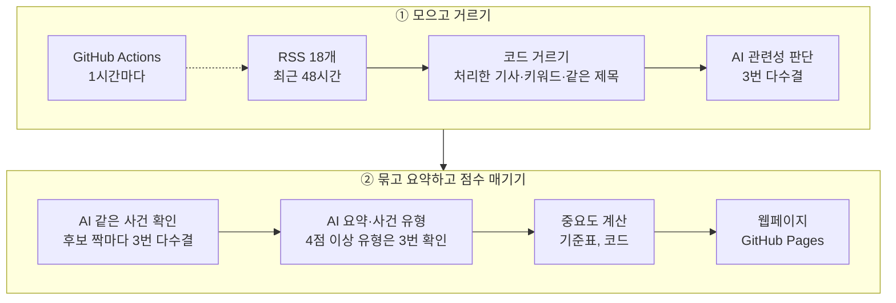

# 반도체 & 디스플레이 뉴스 AI Agent

반도체·디스플레이 업계 뉴스를 **1시간마다 자동으로 모으고**, 같은 사건을 다룬 **중복 기사를 하나로 묶고**, **한국어로 요약**하고, 정해 둔 기준으로 **중요도를 판단**해 웹페이지로 보여주는 AI Agent입니다.

- **웹페이지**: [smyz1203.github.io/semicon-news-agent](https://smyz1203.github.io/semicon-news-agent/)
- **업데이트**: 1시간마다 자동 실행 (GitHub Actions) → GitHub Pages에 배포
- **수집 매체**: RSS 18개
  - 국문 (RSS 9개): 디일렉, 전자신문, KIPOST, 디지털타임스, 연합뉴스, ZDNet Korea, 아이뉴스24, 테크월드뉴스
  - 영문 (RSS 9개): Semiconductor Engineering, Semiconductor Digest, TrendForce, OLED-info, EE Times, DigiTimes Asia, Tom's Hardware, Korea Herald
- **AI**: OpenAI API `gpt-4o-mini` (기본). `config/settings.yaml`의 `provider` 한 줄로 Claude API로 전환
- **기술**: Python 3.12 · feedparser · RapidFuzz · HTML/CSS/JavaScript · GitHub Actions · GitHub Pages

## 만든 이유

뉴스를 직접 찾아 읽으면 검색과 확인에 시간이 많이 들고, 같은 이슈가 여러 매체에 반복 보도돼 중요한 정보를 골라내기 어려웠습니다. 이 반복 작업을 자동화했습니다.

| 기능 | 하는 일 |
| --- | --- |
| 수집 | RSS 18개에서 최근 48시간 기사를 확인하고, 이미 처리한 기사는 건너뜀 |
| 선별 | 키워드 필터 + AI 관련성 판단으로 반도체·디스플레이와 무관한 기사 제외 |
| 중복 제거 | 확실한 중복은 코드가 먼저 묶고, 표현·언어가 다른 같은 사건은 AI가 짝마다 확인해 한 이슈로 묶음 |
| 요약·분류 | 이슈마다 한국어 3문장 요약, 카테고리, 키워드 태그, 사건 유형 |
| 중요도 | AI는 사실(사건 유형·직접 당사자·확정 여부)만 고르고, 점수(1\~5)는 코드가 기준표로 계산 |
| 자동 업데이트 | 1시간마다 실행·배포. 열어 둔 페이지는 새 결과를 스스로 불러옴 |

## 작동 방식



<details>
<summary>단계별로 자세히 보기 (코드 / AI 담당)</summary>

| 순서 | 단계 | 담당 | 하는 일 |
| :---: | --- | :---: | --- |
| 1 | 수집 | 코드 | RSS 18개를 받아 발행된 지 48시간 이내 기사만 남김 |
| 2 | 같은 기사 제거 | 코드 | 이미 처리한 기사, 이번에 같은 주소로 두 번 들어온 기사 제외 |
| 3 | 분야 1차 | 코드 | 일반 매체 기사는 반도체·디스플레이 키워드나 주요 기업 이름이 있어야 통과 (전문 매체는 건너뜀) |
| 4 | 중복 1차 | 코드 | 제목이 거의 같은 기사(유사도 0.6 이상 + 같은 회사)를 한 묶음으로. 진행 중 이슈와 제목이 거의 같으면 바로 그 이슈에 붙임 |
| 5 | 분야 2차 | AI | 기사 20건씩 핵심 사건 한 줄과 관련성을 정리 (3번 묻고 다수결) |
| 6 | 중복 2차 | 코드 + AI | 같은 사건일 수 있는 짝만 골라 AI가 확인하고, 같다고 확인된 짝만 묶음 |
| 7 | 요약·사건 유형 | AI | 이슈마다 한국어 요약, 카테고리, 키워드, 사건 유형 |
| 8 | 중요도 계산 | 코드 | 기준표로 점수 계산 |
| 9 | 저장·배포 | 코드 | `data/`에 커밋하고 웹페이지를 만들어 GitHub Pages에 올림 |

</details>

자세한 설계는 [docs/design.md](docs/design.md)에 있습니다.

## 중복 기사 판단

확실한 중복은 코드가 먼저 거르고, 표현이나 언어가 다른 "같은 사건"인지는 AI가 짝마다 따로 판단합니다. 한 번에 많은 기사를 AI에 맡기면 다른 사건을 붙이거나 같은 사건을 둘로 나누는 실수가 잦아서 이렇게 나눴습니다.

1. **코드 규칙**: 같은 주소이거나, 제목 유사도 0.6 이상 + 언급된 회사가 같고 48시간 이내면 같은 기사
2. **후보 짝 고르기 (코드)**: 새 기사끼리, 또는 새 기사와 최근 72시간 이슈 중 같은 회사가 나오거나 사건 문장이 비슷한 짝만 고름. 회사가 서로 전혀 다르면 제외하고, 기사 하나당 최대 5짝
3. **같은 사건 확인 (AI)**: 짝마다 비교한 이유를 먼저 쓰고 판단. 같은 질문을 3번 묻고 **2번 이상 같다고 할 때만** 묶음. 확인되지 않은 기사는 혼자 새 이슈가 됨

묶은 짝은 Actions 실행 로그에 `같은 사건으로 묶음: A ↔ B`로 남습니다.

> [!NOTE]
> 이미 요약한 이슈에 **다른 매체**의 기사가 새로 붙으면 그 내용까지 넣어 다시 요약합니다. 그래서 수집 현황의 "AI 요약" 수가 "새 이슈" 수보다 많을 수 있습니다 (처음 요약 / 다시 요약으로 나눠 표시).

## 중요도 기준

AI가 점수를 직접 매기면 같은 종류의 기사도 점수가 들쭉날쭉하고, "왜 이 점수인가"에 답할 수 없습니다. 그래서 AI는 기사에서 확인할 수 있는 **사실**만 고르고, 점수는 코드가 정해진 공식으로 계산합니다.

```
중요도 = 사건 유형 기본점 + 가감점 → 1~5점으로 맞춤
```

| 기본점 | 사건 유형 |
| :---: | --- |
| 5 | 신제품·신기술·양산 |
| 4 | 정책·규제·법 |
| 3 | 실적, 가격 동향, 설비 투자, 수주·공급, 경영진 교체, 소송·특허 |
| 2 | 인수합병, 지역·인프라, 채용·인력, 시장 전망·통계, 재무·주주, 업계 일반 |
| 1 | 홍보·수상, 주가 등락, 칼럼·인터뷰 |

| 가감점 | 조건 |
| :---: | --- |
| +1 | 관심 기업이 사건의 직접 당사자 |
| +1 | 서로 다른 매체 3곳 이상이 보도 (같은 언론사의 여러 RSS는 한 곳으로 셈) |
| −1 | 검토·추진·계획·전망·루머처럼 아직 확정되지 않은 사건 |

**관심 기업:** LG디스플레이 · 삼성디스플레이 · 삼성전자 · SK하이닉스 · 엔비디아

- **높은 점수는 확실할 때만**: 기본점 4점 이상 유형(신제품·신기술·양산, 정책·규제·법)을 AI가 고르면, "정말 이 유형이 맞나"를 3번 따로 묻고 2번 이상 맞다고 할 때만 인정합니다. 아니면 그 유형을 빼고 다시 분류합니다. 예: 장학금 수여·품질 인증·특허 등록은 홍보·수상이나 업계 일반으로 갑니다.
- **판단 근거 표시**: 웹의 "판단 근거"에 계산식이 그대로 나옵니다. 예: `수주·공급 3점, 관심 기업(삼성전자) +1 → 4점`
- **기준 바꾸기**: `config/settings.yaml`의 `importance`에서 숫자를 고치면 다음 실행에서 기존 이슈 점수도 AI 호출 없이 다시 계산됩니다.
- **관심 기업과 수집 대상 기업은 따로**: 관심 기업(`importance.watch_companies`)을 줄여도 TSMC·마이크론 같은 기업 기사는 계속 수집됩니다. 수집 대상 기업은 `keywords.companies`에서 관리합니다.

### 정렬 순서

1. **조정 전 점수가 높은 순**: 1\~5점으로 맞추기 전 점수 (예: 같은 5점이어도 조정 전 6점이 5점보다 위)
2. **조정 전 점수가 같으면 보도 시각이 최신인 순**: 여러 기사가 묶인 이슈는 가장 오래된 기사의 발행 시각 기준

이 순서의 1위가 페이지 맨 위 요약 문장("중요도가 가장 높은 이슈는 …")과 "주요 이슈"의 첫 카드에 나옵니다.

## 수집 기간과 보관

| 항목 | 기간 | 설정 |
| --- | --- | --- |
| 수집 범위 | 매 실행마다 최근 **48시간** 기사 확인 | `lookback.max_age_hours` |
| 이미 처리한 기사(주소) 기억 | **14일** | `retention.seen_url_days` |
| 웹페이지 게시 | 이슈가 마지막으로 업데이트된 뒤 **30일** (이후 `data/archive/연-월.json`으로 이동) | `retention.issues_days` |
| 새 기사를 붙일 수 있는 진행 중 이슈 | 마지막 업데이트 후 **72시간** | `retention.active_issue_hours` |
| 실행 기록 | 최근 **100회** | `retention.runs_keep` |

> [!NOTE]
> **1시간마다 실행하는데 48시간을 다시 보는 이유:** RSS에 기사가 늦게 올라오거나, 매체 접속이 잠시 실패하거나, 예약 실행이 늦거나, 실행당 한도(AI 묶기 80묶음·요약 30건) 때문에 미룬 기사를 놓치지 않기 위해서입니다. 이미 처리한 기사는 주소 비교로 건너뛰므로 AI 비용은 들지 않습니다.

처음 실행하거나 "처음부터 다시 만들기"로 초기화하면 처리한 기사 목록이 비어 있어 최근 48시간 기사를 모두 처리합니다. 다만 RSS마다 최근 몇십 건만 담고 있어, 매체에 따라 48시간치가 다 남아 있지 않을 수 있습니다.

## 웹페이지 구성

### 브리핑

- **요약 문장**: 기간 안의 이슈 수, 중요도 4\~5점 수, 중요도가 가장 높은 이슈
- **필터**: 기간(오늘·3일·7일·30일, 기본 3일), 국내/해외(기사 언어 기준), 중요도, 분야, 검색
- **개요 카드 4개**: 이슈 수와 중요도 분포, 새로 잡힌 이슈 추이, 분야별 이슈, 많이 나온 기업
  - 분야·기업을 누르면 그 이슈만 보이고, 다시 누르면 풀림. 기업 → 분야 순으로 좁혀 볼 수 있음
  - 카드에는 상위 5개, "전체 순위 보기"로 전체 순위
- **주요 이슈**: 중요도 4\~5점 중 상위 6개
- **그 밖의 이슈**: 위 정렬 순서대로. 시각 칸은 보도 시각
- **참고자료**: 사건 유형별 기본점, 가감점, 정렬 기준, 관심 기업

### 수집 현황

- **기사가 이슈가 되기까지 (최근 24시간)**: 관련 기사(키워드 통과 기준) → 새 이슈 → AI 요약(처음·다시·대기) → AI 비용(재분류 수)
- **실행 기록 (최근 3일, 1시간 단위)**: 정상 / 일부 매체 실패 / 경고 / 실행 없음
- **수집 매체**: RSS 18개의 상태, 최근 실행 8회, 기사를 많이 낸 매체

## 로컬 환경에서 실행하기

Agent와 웹페이지를 로컬 환경(내 컴퓨터)에서 함께 실행할 수 있습니다. 웹페이지는 브라우저에서 `http://localhost:8000`으로 열리고, 상단 새로고침 버튼을 누르면 이 컴퓨터에서 Agent가 바로 실행됩니다. 토큰은 필요 없습니다.

**필요한 것:** Python 3.12, AI API 키 (`OPENAI_API_KEY`, Claude를 쓰면 `ANTHROPIC_API_KEY`)

다른 컴퓨터에서는 저장소를 내려받은 뒤 같은 방법으로 실행합니다.

```
git clone https://github.com/smyz1203/semicon-news-agent.git
```

### 1. 처음 한 번 준비 (Windows PowerShell)

```powershell
# 가상환경 만들기와 패키지 설치
py -3.12 -m venv .venv
.\.venv\Scripts\python.exe -m pip install -r requirements.txt

# API 키 넣기: .env.example을 복사해 .env를 만들고 키를 붙여넣기
Copy-Item .env.example .env
notepad .env
```

### 2. 실행

폴더의 **`run-local.cmd`를 더블클릭**하면 브라우저에 `http://localhost:8000`이 열립니다. 옵션을 붙이려면 그 폴더에서 PowerShell을 열고 실행합니다.

```powershell
./run-local.cmd --every 60 --run-now   # 켜자마자 한 번 실행하고, 켜 두는 동안 60분마다 자동 실행
```

| 옵션 | 하는 일 |
| --- | --- |
| `--every 60` | 켜 두는 동안 60분마다 자동 실행 (첫 실행은 60분 뒤) |
| `--run-now` | 켜자마자 한 번 실행 |
| `--data-dir data` | GitHub에서 받은 데이터(`data/`)를 그대로 보기 |
| `--port 8001` | 8000번 포트를 이미 쓰고 있을 때 다른 포트로 열기 |

- 결과는 기본으로 `local-data/` 폴더에 저장되며 저장소에 올라가지 않습니다. GitHub Pages의 데이터(`data/`)와는 서로 따로 업데이트됩니다.
- 이 컴퓨터에서만 접속할 수 있고, 실행 요청은 이 페이지의 버튼에서 온 것만 받습니다. 창을 닫거나 컴퓨터가 꺼지면 멈춥니다.
- Mac·리눅스에서는 `python -m agent.serve`에 같은 옵션을 붙여 실행합니다.

<details>
<summary>그 밖의 명령</summary>

```powershell
.\.venv\Scripts\python.exe -m agent.main --dry-run                          # AI 없이 수집만 (비용 0원)
.\.venv\Scripts\python.exe -m agent.main --limit 5 --data-dir local-data    # 소량만 실행
.\.venv\Scripts\python.exe -m pytest -q                                     # 테스트
```

</details>

## 설정 바꾸기

모두 `config/` 폴더의 YAML 파일만 고치면 됩니다.

| 바꾸고 싶은 것 | 파일 · 항목 |
| --- | --- |
| 중요도 기준표(사건 유형·기본점·가감점), 관심 기업 | `settings.yaml` → `importance` |
| 확실할 때만 주는 기본점 기준 (기본 4점 이상) | `settings.yaml` → `importance.strict_min_score` |
| 관련 기사로 보는 키워드·기업 (1차 거르기) | `settings.yaml` → `keywords` |
| 카테고리 | `settings.yaml` → `categories` |
| AI 제공사 (OpenAI ↔ Claude) | `settings.yaml` → `provider` (`openai` 또는 `claude`) |
| AI 모델, 생각 깊이(effort) | `settings.yaml` → `openai.model` / `claude.model`, `effort` |
| 비용 한도 (실행당 묶음·요약 수) | `settings.yaml` → `limits` |
| 수집 범위, 보관 기간 | `settings.yaml` → `lookback`, `retention` |
| 수집 매체 추가·끄기 | `sources.yaml` (같은 언론사의 RSS는 `name`을 같게 쓰면 한 매체로 셈) |
| 실행 주기 | `.github/workflows/update.yml` → `cron` |

## 운영 메모

- **처음 한 번**: 저장소 Settings → Pages → Build and deployment → Source를 **GitHub Actions**로 바꾼 뒤, Actions 탭에서 "뉴스 업데이트"를 수동 실행(Run workflow)합니다.
- **API 키 보관**: 로컬 실행용 `.env`는 저장소에 올리지 않습니다. GitHub Actions는 저장소 Settings → Secrets and variables → Actions(또는 `gh secret set OPENAI_API_KEY`)에 암호화해 저장한 키를 씁니다. 제공사를 바꾸면 그 제공사의 키도 등록해야 합니다.
- **비용**: 수집 현황의 "최근 실행"에 회차별 추정 비용이 나옵니다. 쓰는 제공사의 콘솔(OpenAI: platform.openai.com의 Limits, Anthropic: console.anthropic.com)에서 월 사용 한도를 걸어 두세요.
- **일부 매체 실패**: 매체 한 곳의 접속이 잠시 실패해도 나머지는 계속 수집하고, 놓친 기사는 다음 실행이 48시간 안 기사를 다시 보며 받아 갑니다. 같은 매체가 계속 실패하면 수집 매체 목록에 "실패 N회 연속"으로 나옵니다.
- **알림**: 매체 과반 수집 실패, AI 중단(크레딧 부족 등), 24시간 새 기사 없음이면 Actions 실행이 실패로 표시되고 GitHub이 메일을 보냅니다.
- **AI가 멈췄을 때**: 이슈 묶기를 못 한 기사는 다음 실행으로 미루고, 요약을 못 한 이슈는 "요약 대기"로 먼저 게시한 뒤 다음 실행에서 다시 요약합니다.
- **60일 규칙**: 공개 저장소는 60일 동안 활동이 없으면 예약 실행이 꺼질 수 있습니다. 45일에 한 번쯤 설정을 다듬는 커밋을 하면 안전합니다. 웹페이지 상단에는 업데이트가 3시간 넘게 멈추면 경고가 뜹니다.

## 폴더 구조

```
agent/          Python Agent
  main.py         전체 흐름 실행 (--dry-run, --limit, --rebuild)
  collect.py      RSS 수집
  dedupe.py       1차 중복·관련성 거르기, 같은 사건 후보 짝 고르기
  analyze.py      AI(OpenAI/Claude): 사건 정리·관련성, 같은 사건 확인, 요약·사건 분류·유형 확인
  score.py        중요도 계산 (기준표 + 가감점)
  prompts.py      AI 지시문
  models.py       AI 응답 형식
  store.py        JSON 저장·보관
  build_site.py   웹페이지 만들기
  health.py       실행 결과 점검
  serve.py        로컬 환경(localhost)용 웹페이지 + 실행 서버
config/         설정 (settings.yaml: 모델·한도·카테고리·중요도 기준, sources.yaml: RSS 목록)
data/           Agent 결과 (GitHub Actions가 자동 커밋)
web/            웹페이지 (HTML/CSS/JS)
tests/          테스트 (pytest)
docs/design.md  설계 문서
.github/workflows/  update.yml (1시간마다 실행·배포), test.yml (PR마다 테스트)
run-local.cmd   로컬 환경에서 실행 (Windows)
```

`local-data/`(로컬 실행 결과), `.env`(API 키), `.venv`(가상환경)는 저장소에 올라가지 않습니다.

## 저작권과 한계

- 기사 본문은 저장하거나 게시하지 않습니다. 제목, 매체명, 원문 링크, AI가 새로 쓴 요약만 보여줍니다.
- AI의 관련성 판단, 중복 묶기, 요약, 사건 분류는 틀릴 수 있습니다 (중요도는 그 분류로 계산하므로 같이 틀립니다). 묶기는 확실할 때만 하므로 같은 뉴스가 따로 남는 경우도 있습니다. 판단 전에 원문을 확인하세요.
- 기사 원문 페이지를 열지 않고 RSS에 담긴 내용(대부분 짧은 요약문)으로만 요약하므로, 세부 내용은 원문보다 적습니다.
