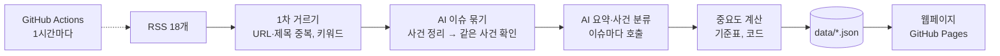

# 반도체·디스플레이 뉴스 AI Agent

반도체·디스플레이 업계 뉴스를 **1시간마다 자동으로 모으고**, 같은 이슈를 다룬 **중복 기사를 하나로 묶고**, **한국어로 요약**하고, 내가 정한 기준으로 **중요도를 판단**해 웹페이지로 보여주는 AI Agent입니다.

- 웹페이지: `https://smyz1203.github.io/semicon-news-agent/` (GitHub Pages)
- 수집 매체: 국내 9개 · 해외 9개 RSS (디일렉, 전자신문, KIPOST, 연합뉴스, 아이뉴스24, 테크월드뉴스, Semiconductor Engineering, Semiconductor Digest, TrendForce, OLED-info 등)
- AI: OpenAI API (기본) 또는 Claude API — `config/settings.yaml`의 `provider` 한 줄로 전환

## 왜 만들었나

뉴스를 직접 찾아 읽으면 검색과 확인에 시간이 많이 들고, 같은 이슈를 다룬 기사가 여러 매체에 반복돼 중요한 정보를 골라내기 어려웠습니다. 이 반복 작업을 자동화된 workflow로 바꿨습니다.

| 기능 | 하는 일 |
| --- | --- |
| 수집 | 국내·해외 RSS 18개에서 마지막 실행 이후 올라온 기사를 가져옴 |
| 중복 제거 | URL·제목 유사도로 1차 정리한 뒤, 같은 사건일 수 있는 짝마다 AI가 확인해 같은 사건으로 확인된 기사(국문·영문 포함)만 하나의 이슈로 묶음 |
| 선별 | 키워드 필터 + AI 관련성 판단으로 무관한 기사 제외 |
| 요약·분류 | 이슈마다 한국어 3줄 요약, 카테고리, 키워드 태그 |
| 중요도 판단 | AI는 사건 유형·직접 당사자·확정 여부만 고르고, 점수(1~5)는 코드가 기준표로 계산. 4~5점은 웹 상단 "주요 이슈"에 |
| 자동 업데이트 | GitHub Actions가 1시간마다 실행하고 Pages에 배포. 열어 둔 페이지는 새 결과를 스스로 불러옴 |

## 작동 방식



자세한 설계는 [docs/design.md](docs/design.md)에 있습니다.

## 중요도 기준

AI가 점수를 직접 매기면 같은 종류의 기사도 점수가 들쭉날쭉하고, "왜 이 점수인가"에 답할 수 없습니다. 그래서 AI는 기사에서 확인할 수 있는 **사실**만 고르고, 점수는 코드가 정해진 공식으로 계산합니다.

```
중요도 = 사건 유형 기본점 + 가감점 → 1~5점으로 맞춤
```

| 기본점 | 사건 유형 |
| --- | --- |
| 5 | 신제품·신기술·양산 |
| 4 | 정책·규제·법 |
| 3 | 실적, 가격 동향, 설비 투자, 수주·공급, 경영진 교체, 소송·특허 |
| 2 | 인수합병, 지역·인프라, 채용·인력, 시장 전망·통계, 재무·주주, 업계 일반 |
| 1 | 홍보·수상, 주가 등락, 칼럼·인터뷰 |

| 가감점 | 조건 |
| --- | --- |
| +1 | 관심 기업이 사건의 직접 당사자 |
| +1 | 서로 다른 매체 3곳 이상이 보도 (코드가 기사 출처로 셈) |
| −1 | 검토·추진·계획·전망·루머처럼 아직 확정되지 않은 사건 |

| 순서 | 관심 기업 |
| --- | --- |
| 1 | LG디스플레이 |
| 2 | 삼성디스플레이 |
| 3 | 삼성전자 |
| 4 | SK하이닉스 |
| 5 | 엔비디아 |

관심 기업은 `importance.watch_companies`에서 바꿉니다. 1차 거르기에서 "제목에 이 기업 이름이 있으면 관련 기사"로 보는 기업 목록(`keywords.companies`)은 따로 관리하므로, 관심 기업을 줄여도 TSMC·마이크론 같은 기업 기사는 계속 수집됩니다.

기본점이 높은 유형(4점 이상: 신제품·신기술·양산, 정책·규제·법)은 **확실할 때만** 줍니다. AI가 이 유형을 고르면 "정말 이 유형이 맞나"를 세 번 따로 묻고, 둘 이상 맞다고 할 때만 그대로 두고 아니면 그 유형을 빼고 다시 분류합니다 (`importance.strict_min_score`). 예: 장학금 수여·품질 인증·특허 등록은 신제품·신기술이 아니라 홍보·수상, 업계 일반으로 갑니다.

웹의 "판단 근거"에는 계산식이 그대로 나옵니다. 예: `수주·공급 3점, 관심 기업(삼성전자) +1 → 4점`. 기준표는 `config/settings.yaml`의 `importance`에 있고, 숫자를 고치면 다음 실행에서 기존 이슈 점수도 AI 호출 없이 다시 계산됩니다.

## 폴더 구조

```
agent/          Python Agent
  main.py         전체 흐름 실행
  collect.py      RSS 수집
  dedupe.py       1차 중복·관련성 거르기
  analyze.py      AI(OpenAI/Claude): 이슈 묶기, 요약·사건 분류
  score.py        중요도 계산 (기준표 + 가감점)
  prompts.py      AI 지시문
  store.py        JSON 저장
  build_site.py   웹페이지 만들기
  health.py       실행 결과 점검
  serve.py        내 PC(localhost)에서 웹페이지 + 실행 서버
config/         설정 (모델, 한도, 카테고리, 중요도 기준, RSS 목록)
data/           Agent 결과 (Actions가 자동 커밋)
web/            웹페이지 (HTML/CSS/JS)
tests/          테스트
docs/design.md  설계 문서
```

## 내 컴퓨터에서 실행하기 (localhost, GitHub 없이)

Agent와 웹페이지를 내 PC에서 함께 띄울 수 있습니다. 이때 상단 새로고침 버튼은 GitHub 대신 **내 PC에서 Agent를 실행**하며, 토큰이 필요 없습니다.

처음 한 번 (Windows PowerShell):

```powershell
# 1. 가상환경 만들기와 패키지 설치
py -3.12 -m venv .venv
.\.venv\Scripts\python.exe -m pip install -r requirements.txt

# 2. API 키 넣기: .env.example을 복사해 .env를 만들고 OPENAI_API_KEY(또는 Claude면 ANTHROPIC_API_KEY)를 붙여넣기
Copy-Item .env.example .env
notepad .env
```

실행: 폴더의 **`run-local.cmd`를 더블클릭**하거나 아래 명령을 실행하면 브라우저에 `http://localhost:8000`이 열립니다.

```powershell
.\.venv\Scripts\python.exe -m agent.serve                 # 새로고침 버튼으로 실행
.\.venv\Scripts\python.exe -m agent.serve --every 180     # 켜 두는 동안 180분마다 자동 실행
.\.venv\Scripts\python.exe -m agent.serve --run-now       # 켜자마자 한 번 실행
```

- 결과는 `local-data/` 폴더에 저장되며 GitHub에 올라가지 않습니다 (GitHub에서 도는 데이터 `data/`와 섞이지 않음).
- 이 컴퓨터에서만 접속할 수 있고, 실행 요청은 이 페이지의 버튼에서 온 것만 받습니다.

그 밖의 명령:

```powershell
.\.venv\Scripts\python.exe -m agent.main --dry-run                          # AI 없이 수집만 (비용 0원)
.\.venv\Scripts\python.exe -m agent.main --limit 5 --data-dir local-data    # 소량만 실행
.\.venv\Scripts\python.exe -m pytest -q                                     # 테스트
```

## 설정 바꾸기

모두 `config/` 폴더의 YAML 파일만 고치면 됩니다.

| 바꾸고 싶은 것 | 파일 · 항목 |
| --- | --- |
| 중요도 기준표(사건 유형·기본점·가감점), 관심 기업 | `settings.yaml` → `importance` |
| 카테고리 | `settings.yaml` → `categories` |
| AI 제공사 (OpenAI ↔ Claude) | `settings.yaml` → `provider` (`openai` 또는 `claude`) |
| AI 모델, 생각 깊이(effort) | `settings.yaml` → `openai.model` / `claude.model`, `effort` |
| 비용 한도 (실행당 기사·요약 수) | `settings.yaml` → `limits` |
| 수집 매체 추가·끄기 | `sources.yaml` |
| 실행 주기 | `.github/workflows/update.yml` → `cron` |

## 지금 바로 업데이트하기 (시연)

페이지는 토큰 없이 **스스로 업데이트를 알아챕니다.** 열어 둔 페이지는 1분마다 새 결과를 확인하고, 실행이 시작되면 "뉴스 수집·요약 중 · N분 경과"처럼 진행 상황을 보여주다가 결과가 올라오면 저절로 새로고침합니다. 그래서 면접관 컴퓨터에서는 아무것도 입력하거나 누를 필요가 없습니다.

**시연 중에 바로 새로 실행하기 (휴대폰 GitHub 앱):**

1. 휴대폰에 GitHub 앱을 설치하고 `smyz1203` 계정으로 로그인 (처음 한 번)
2. `semicon-news-agent` 저장소 → **Actions** → **뉴스 업데이트** → **Run workflow**
3. 면접관 화면의 페이지가 1~2분 안에 실행을 알아채 진행 상황을 보여주고, 3~4분 뒤 새 뉴스로 바뀝니다

- 면접관 컴퓨터에서 새로고침 아이콘을 누르면 실행 요청 대신 최신 결과를 확인합니다 (실행 중이면 진행 상황 표시).
- 실행하지 않아도 1시간마다 자동 실행되므로, 페이지에는 항상 1시간 이내의 뉴스가 보입니다.
- **처음부터 다시 만들기**: 기준표나 묶기 규칙을 바꾼 뒤 기존 이슈도 새 기준으로 다시 판단하려면 Run workflow에서 **rebuild**를 체크하고 실행합니다. 이슈·이미 본 기사·실행 기록을 비우고 최근 48시간 기사를 다시 처리합니다. 한 번에 AI 묶기 80묶음·요약 30건까지만 하므로, 남은 것은 다음 실행(수동 또는 매시 자동)에서 이어서 합니다.

**내 PC에서 아이콘으로 바로 실행하고 싶다면 (선택):** 그 브라우저에만 GitHub 토큰을 저장할 수 있습니다. 페이지 주소 끝에 `#setup`을 붙여 열면 저장 창이 나옵니다. 토큰은 [Fine-grained token](https://github.com/settings/personal-access-tokens/new)으로 만들고, Repository access → **Only select repositories** → `semicon-news-agent`, Permissions → **Actions: Read and write**만 줍니다. 토큰은 그 브라우저에만 저장되며 어디에도 올라가지 않습니다. 공용 컴퓨터에서는 저장하지 마세요.

## 운영 메모

- **처음 한 번**: 저장소 Settings → Pages → Build and deployment → Source를 **GitHub Actions**로 바꾼 뒤, Actions 탭에서 "뉴스 업데이트"를 수동 실행(Run workflow)합니다.
- **비밀값**: 쓰는 제공사의 키(`OPENAI_API_KEY` 또는 `ANTHROPIC_API_KEY`)를 저장소 Settings → Secrets and variables → Actions에 저장합니다. 제공사를 바꾸면 그 제공사의 키도 등록해야 합니다. `.env`는 GitHub에 올라가지 않습니다.
- **비용**: 웹페이지 아래 "최근 실행"에 회차별 추정 비용이 나옵니다. 쓰는 제공사의 콘솔(OpenAI: platform.openai.com의 Limits, Anthropic: console.anthropic.com)에서 월 사용 한도를 걸어 두세요.
- **알림**: 매체 과반 수집 실패, AI 중단(크레딧 부족 등), 24시간 새 기사 없음이면 Actions 실행이 실패로 표시되고 GitHub이 메일을 보냅니다.
- **AI가 멈췄을 때**: 기사는 "요약 대기"로 먼저 게시되고, 다음 실행에서 다시 요약합니다.
- **60일 규칙**: 공개 저장소는 60일 동안 활동이 없으면 예약 실행이 꺼질 수 있습니다. 45일에 한 번쯤 설정을 다듬는 커밋을 하면 안전합니다. 웹페이지 상단에 업데이트가 6시간 넘게 멈추면 경고가 뜹니다.

## 저작권과 한계

- 기사 본문은 저장하거나 게시하지 않습니다. 제목, 매체명, 원문 링크, AI가 새로 쓴 요약만 보여줍니다.
- AI 요약과 사건 분류는 틀릴 수 있습니다 (중요도는 그 분류로 계산하므로 같이 틀립니다). 판단 전에 원문을 확인하세요.
- 기사 원문 페이지를 열지 않고 RSS에 담긴 내용(대부분 짧은 요약문)으로만 요약하므로, 세부 내용은 원문보다 적습니다.

## 기술

Python 3.12 · OpenAI Python SDK / Anthropic Python SDK (구조화 출력) · feedparser · RapidFuzz · GitHub Actions · GitHub Pages · HTML/CSS/JavaScript
