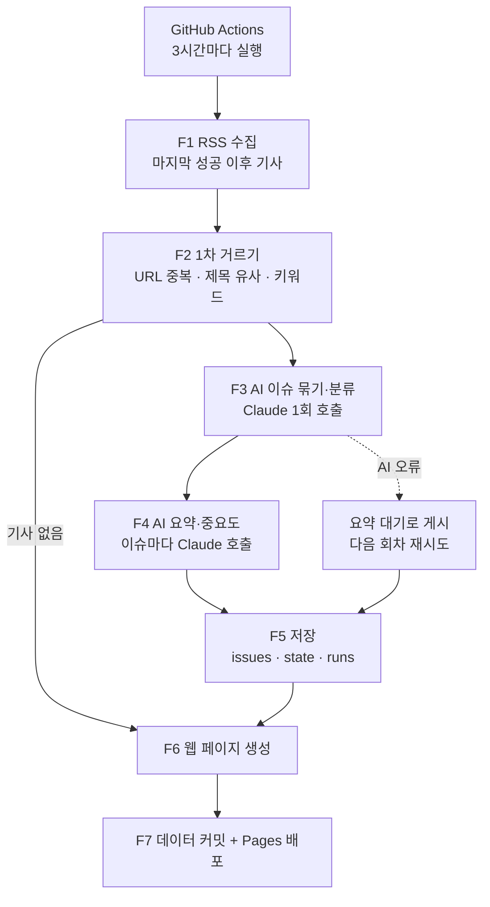

# 설계 문서 — 반도체·디스플레이 뉴스 AI Agent

## 1. 문제 정의

| 기존 방식의 문제 | Agent가 해결하는 방법 |
| --- | --- |
| 여러 매체를 돌아다니며 기사를 검색·확인하는 데 시간이 많이 듦 | 국내·해외 18개 RSS를 3시간마다 자동 수집 |
| 같은 이슈를 다룬 중복 기사가 많음 | 규칙 기반 1차 거르기 + AI가 같은 이슈끼리 묶어 카드 하나로 |
| 필요한 정보를 고르기 어려움 | 키워드 필터 + AI 관련성 판단, 카테고리·키워드 분류 |
| 무엇이 중요한지 매번 판단해야 함 | 사용자가 정한 중요도 기준으로 AI가 1~5점과 이유를 매기고, 중요한 이슈를 맨 위에 |

## 2. 기능 정의

| ID | 기능 | 입력 | 출력 | 구현 |
| --- | --- | --- | --- | --- |
| F1 | 뉴스 수집 | `config/sources.yaml` | 기사 목록 (제목, 링크, 매체, 시각, 요약문) | `agent/collect.py` |
| F2 | 1차 중복·관련성 거르기 | F1 기사 목록, 이미 본 URL | 중복 제거된 기사 묶음 | `agent/dedupe.py` |
| F3 | 이슈 묶기·분류 (AI) | F2 결과, 진행 중인 이슈 | 기사별 이슈 배정, 카테고리, 관련 여부 | `agent/analyze.py` |
| F4 | 요약·중요도 판단 (AI) | 이슈별 기사, 중요도 기준 | 헤드라인, 3줄 요약, 태그, 기업, 중요도 1~5, 이유 | `agent/analyze.py` |
| F5 | 저장·보관 | F3·F4 결과 | `data/issues.json`, `state.json`, `runs.json`, `archive/` | `agent/store.py` |
| F6 | 웹 인터페이스 | `data/*.json` | 필터·검색·주요 이슈가 있는 대시보드 | `web/`, `agent/build_site.py` |
| F7 | 주기 실행·배포 | 3시간 주기 | 데이터 커밋 + GitHub Pages 배포 | `.github/workflows/update.yml` |

## 3. 작업 흐름



### 단계별 규칙

1. **수집**: 매체마다 독립적으로 처리해서, 한 곳이 실패해도 나머지는 계속한다. 마지막으로 성공한 실행보다 30분 앞부터 가져와 늦게 올라온 기사도 놓치지 않는다. 시간대가 없는 날짜는 매체 설정의 시간대(국내는 KST)로 해석한다.
2. **1차 거르기** (비용 없음)
   - URL을 정규화(추적용 파라미터 제거)해서 같은 기사와 이미 본 기사를 뺀다.
   - 제목을 정규화하고 글자 단위 유사도가 기준 이상이면서 **언급된 회사가 같을 때만** 한 묶음으로 본다. 다른 회사의 비슷한 제목(예: 각 사의 "3분기 영업이익")이 합쳐지는 것을 막기 위해서다.
   - 일반 매체는 관련 키워드가 있는 기사만 남긴다.
3. **이슈 묶기·분류 (AI)**
   - 새 기사 묶음과 최근 72시간의 진행 중 이슈를 함께 보여주고, 기사마다 "기존 이슈에 붙일지 / 새 이슈인지 / 관련 없는지"와 카테고리를 JSON으로 받는다.
   - 응답은 코드로 검증한다. 모든 기사가 한 번씩 배정됐는지, 없는 이슈 id를 쓰지 않았는지 확인하고, 실패하면 묶음마다 새 이슈로 처리한다.
4. **요약·중요도 (AI)**
   - 새 이슈, 그리고 다른 매체 기사가 새로 붙은 이슈만 요약한다.
   - 기사 문장을 그대로 옮기지 않고 3줄로 새로 쓴다.
   - 중요도는 설정 파일의 기준으로 1~5점을 매기고 이유를 한 줄로 남긴다.
5. **저장**: 임시 파일에 쓴 뒤 교체(원자적 쓰기)한다. 30일이 지난 이슈는 월별 보관 파일로 옮긴다.
6. **게시 원칙**: 공개 저장소와 웹에는 헤드라인, 매체명, 시각, 원문 링크, AI 요약, 태그, 중요도만 올린다. 기사 본문, RSS 요약문, 이미지는 올리지 않는다.

## 4. 데이터 구조

### `data/issues.json`

```json
{
  "version": 1,
  "updated_at": "2026-10-26T03:17:00Z",
  "issues": [
    {
      "id": "c20261026-0007",
      "headline": "삼성전자, 엔비디아에 HBM4 공급 확정",
      "summary": ["…", "…", "…"],
      "category": "메모리",
      "tags": ["HBM4", "엔비디아"],
      "companies": ["삼성전자", "엔비디아"],
      "importance": 5,
      "importance_reason": "…",
      "status": "summarized",
      "region": "both",
      "first_seen": "2026-10-26T00:17:00Z",
      "updated_at": "2026-10-26T03:17:00Z",
      "articles": [
        {"key": "3f2a…", "title": "…", "url": "…", "source": "디일렉", "lang": "ko", "published_at": "…"}
      ]
    }
  ]
}
```

- `status`: `summarized`(요약 완료) 또는 `pending`(AI 오류로 요약 대기)
- `region`: `ko`(국내 기사만), `en`(해외 기사만), `both`(둘 다)

### `data/state.json`

마지막 성공 시각, 이미 본 URL(14일), 매체별 상태(마지막 성공·연속 실패·마지막 새 기사 시각)를 담는다.

### `data/runs.json`

실행마다 수집 수, 거르기 후 수, 새 이슈 수, 요약 수, AI 호출 수, 토큰 사용량, 추정 비용(USD), 오류를 기록한다.

## 5. AI 사용 설계

| 호출 | 모델 | 횟수 | 입력 | 출력 (JSON 스키마) |
| --- | --- | --- | --- | --- |
| 이슈 묶기·분류 | `claude-sonnet-5-5` (설정 변경 가능) | 실행당 1회 (기사 80건 넘으면 나눠서) | 기사 제목·요약문 200자, 진행 중 이슈 | `assignments[]`, `new_issues[]` |
| 요약·중요도 | 같음 | 이슈당 1회, 실행당 최대 30회 | 이슈의 기사 최대 4건 (각 1,500자) | headline, summary[3], tags, companies, importance, reason |

- 구조화 출력: `client.beta.messages.parse(output_format=Pydantic 모델)`
- 프롬프트 캐싱: 중요도 기준이 담긴 시스템 프롬프트를 캐시해서 같은 실행 안의 반복 호출 비용을 줄인다.
- 서버측 fallback: 요청이 거절되면 서버가 다른 모델로 다시 시도한다.
- 기사 내용은 신뢰할 수 없는 입력이므로 AI에게 도구를 주지 않고, 지정한 JSON 형식으로만 답하게 한다.

## 6. 운영 위험과 대응

| 위험 | 대응 |
| --- | --- |
| 예약 실행이 멈춤 (60일 무활동 규칙 등) | 웹에 "마지막 업데이트" 경고, 실패 메일, `gh workflow enable`, 주기적인 사람 커밋 |
| RSS 끊김·차단 | 매체별 독립 처리, 상태 패널, 과반이 실패하면 실행 실패로 알림 |
| API 크레딧 소진·한도 초과 | AI 호출을 멈추고 "요약 대기"로 게시, 다음 회차 재시도 |
| 데이터 파일 손상 | 원자적 쓰기, 동시 실행 방지, push 실패 시 실행 실패 |
| 저작권 | 우리 요약 + 링크만 게시, 원문 미수집, 안내문, 검색엔진 비노출 |
